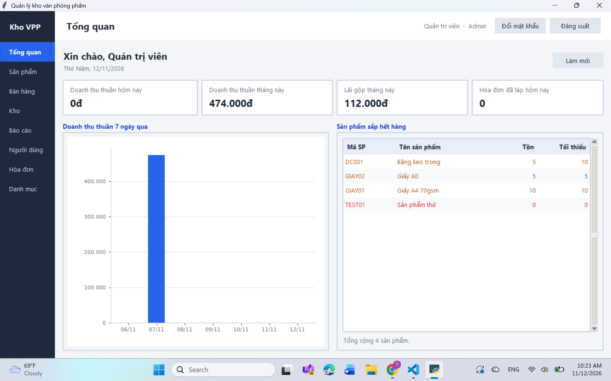
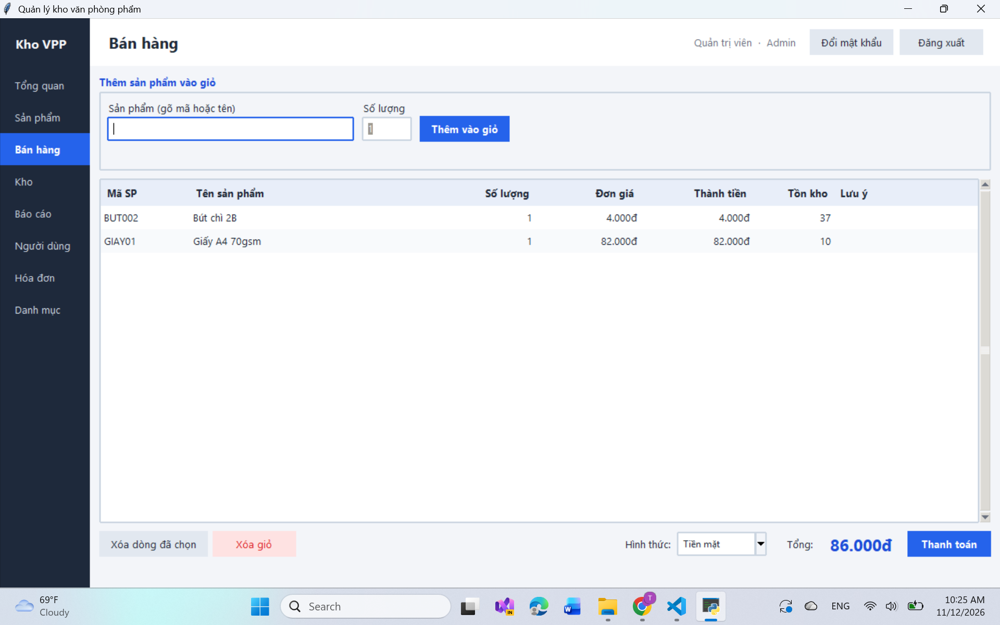
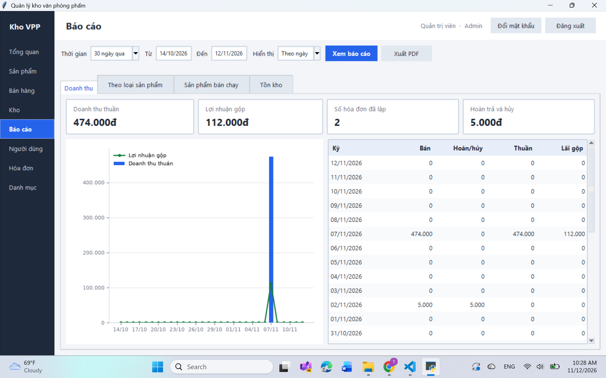

# Ứng dụng Quản lý kho văn phòng phẩm

Ứng dụng desktop quản lý kho và bán hàng cho cửa hàng văn phòng phẩm, viết bằng **Python (Tkinter)** và **MySQL**, tổ chức theo mô hình **MVC**.

> Đồ án môn học · Tác giả: `[Họ tên]` · Lớp/Khoa: `[Lớp - Khoa]` · Năm: `[Năm]`

## Mục lục

1. [Tính năng](#1-tính-năng)
2. [Phân quyền](#2-phân-quyền)
3. [Cài đặt nhanh trong 8 bước](#3-cài-đặt-nhanh-trong-8-bước)
4. [Hướng dẫn cài đặt chi tiết](#4-hướng-dẫn-cài-đặt-chi-tiết)
5. [Hướng dẫn sử dụng nhanh](#5-hướng-dẫn-sử-dụng-nhanh)
6. [Quy tắc nghiệp vụ](#6-quy-tắc-nghiệp-vụ)
7. [Kiến trúc và cấu trúc thư mục](#7-kiến-trúc-và-cấu-trúc-thư-mục)
8. [Cơ sở dữ liệu](#8-cơ-sở-dữ-liệu)
9. [Bảo mật](#9-bảo-mật)
10. [Xử lý sự cố](#10-xử-lý-sự-cố)
11. [Giới hạn đã biết và hướng phát triển](#11-giới-hạn-đã-biết-và-hướng-phát-triển)

---

## 1. Tính năng

| Nhóm | Chức năng |
|---|---|
| **Tổng quan** | Màn hình đầu tiên sau đăng nhập, nội dung khác nhau theo vai trò; cảnh báo sản phẩm sắp hết hàng khi mở app (Admin, Thủ kho) |
| **Sản phẩm** | Thêm, sửa, ngừng kinh doanh (xóa mềm); tìm kiếm có gợi ý khi gõ, lọc theo loại, sắp xếp, phân trang; dòng sắp hết hàng tô đỏ |
| **Danh mục** | Quản lý loại sản phẩm, đơn vị tính, nhà cung cấp |
| **Kho** | Lập phiếu nhập nhiều dòng (tự tính giá vốn bình quân, cảnh báo giá nhập bất thường); lịch sử phiếu nhập; **thẻ kho** từng sản phẩm kèm đối chiếu sổ |
| **Bán hàng** | Lập hóa đơn bằng bàn phím (gõ mã, Enter); giỏ hàng tự cập nhật giá; chống bán quá tồn kho |
| **Hóa đơn** | Tìm theo mã và khoảng ngày; xem chi tiết; **in hóa đơn PDF**; **trả hàng** (trong 3 ngày); hủy hóa đơn (chỉ Admin) |
| **Báo cáo** | Doanh thu thuần và lãi gộp theo ngày/tháng/năm; theo loại sản phẩm; sản phẩm bán chạy; tồn kho; **biểu đồ**; **xuất PDF** |
| **Người dùng** | Thêm, khóa, đổi vai trò, đặt lại mật khẩu bằng mật khẩu tạm; mỗi người tự đổi mật khẩu của mình |
| **Hệ thống** | Nhật ký hoạt động; phân quyền ba vai trò; mật khẩu băm bcrypt |

Ảnh chụp màn hình (thêm vào thư mục `docs/anh/` rồi sửa đường dẫn):

| Tổng quan | Bán hàng | Báo cáo |
|---|---|---|
|  |  |  |

## 2. Phân quyền

Ứng dụng có ba vai trò. Việc kiểm tra quyền được thực hiện **ở tầng Controller** (không chỉ ẩn menu), nên không thể vượt quyền bằng cách gọi trực tiếp chức năng.

| Chức năng | Admin | Thủ kho | Nhân viên bán hàng |
|---|:---:|:---:|:---:|
| Tổng quan | ✔ (doanh thu, lãi gộp) | ✔ (số liệu kho) | ✔ (chỉ của bạn) |
| Xem sản phẩm | ✔ | ✔ | ✔ (**không thấy giá nhập**) |
| Thêm, sửa, ngừng kinh doanh sản phẩm | ✔ | ✔ | ✗ |
| Danh mục, đơn vị tính, nhà cung cấp | ✔ | ✔ | ✗ |
| Nhập kho, lịch sử phiếu nhập, thẻ kho | ✔ | ✔ | ✗ |
| Bán hàng | ✔ | ✗ | ✔ |
| Xem, tìm, in hóa đơn; trả hàng | ✔ | ✗ | ✔ |
| **Hủy hóa đơn** | ✔ | ✗ | ✗ |
| Báo cáo và xuất PDF | ✔ | ✗ | ✗ |
| Quản lý người dùng | ✔ | ✗ | ✗ |
| Đổi mật khẩu của chính mình | ✔ | ✔ | ✔ |

---

## 3. Cài đặt nhanh trong 8 bước

Dành cho Windows. Các bước giải thích kỹ hơn nằm ở [mục 4](#4-hướng-dẫn-cài-đặt-chi-tiết).

```powershell
# 1. Cài Python 3.10 trở lên (tích "Add Python to PATH") và MySQL Server 8.0.16 trở lên.
# 2. Mở PowerShell trong thư mục dự án, tạo môi trường ảo và cài thư viện:
python -m venv venv
venv\Scripts\Activate.ps1
pip install -r requirements.txt

# 3. Tạo cơ sở dữ liệu (nhập mật khẩu root MySQL khi được hỏi):
mysql -u root -p --default-character-set=utf8mb4 < database\quan_ly_kho_vpp.sql
mysql -u root -p --default-character-set=utf8mb4 < database\cap_nhat_csdl.sql

# 4. Cấu hình kết nối:
copy .env.example .env
notepad .env                      # điền DB_USER và DB_PASSWORD

# 5. Tạo tài khoản Admin đầu tiên:
python create_admin.py

# 6. Kiểm tra mọi thứ đã khớp:
python kiem_tra_nhanh.py

# 7. Chạy ứng dụng:
python main.py

# 8. Đăng nhập bằng tài khoản admin vừa tạo.
```

---

## 4. Hướng dẫn cài đặt chi tiết

### 4.1. Yêu cầu hệ thống

| Thành phần | Phiên bản | Ghi chú |
|---|---|---|
| Hệ điều hành | Windows 10/11 (đã dùng để phát triển), Linux, macOS | Giao diện Tkinter chạy trên cả ba |
| Python | **3.10 trở lên** (khuyến nghị 3.12) | Bản cài từ python.org đã kèm Tkinter |
| **MySQL Server** | **8.0.16 trở lên** | Cần cho ràng buộc `CHECK` và câu lệnh `FOR UPDATE OF`. **Không dùng MariaDB** |
| MySQL Workbench | Bất kỳ | Tùy chọn, tiện để chạy file SQL và xem dữ liệu |
| Phông chữ | Không cần cài thêm | PDF dùng phông DejaVu Sans đi kèm thư viện matplotlib |

Thư viện Python (đã liệt kê trong `requirements.txt`):

| Thư viện | Dùng để |
|---|---|
| `mysql-connector-python` | Kết nối MySQL |
| `bcrypt` | Băm mật khẩu |
| `python-dotenv` | Đọc cấu hình từ file `.env` |
| `matplotlib` | Vẽ biểu đồ (và cung cấp phông chữ cho PDF) |
| `reportlab` | Xuất file PDF |

### 4.2. Cài Python

1. Tải Python từ <https://www.python.org/downloads/>.
2. Khi cài, **tích chọn "Add Python to PATH"**.
3. Kiểm tra: mở PowerShell và chạy `python --version`.

Trên Linux, nếu thiếu Tkinter: `sudo apt install python3-tk python3-venv`.

### 4.3. Cài MySQL

1. Tải **MySQL Community Server 8.0** (hoặc mới hơn) từ <https://dev.mysql.com/downloads/mysql/>, cài đặt và **ghi nhớ mật khẩu tài khoản `root`** đặt trong lúc cài.
2. (Tùy chọn) cài thêm **MySQL Workbench**.
3. Kiểm tra dịch vụ MySQL đang chạy (Windows: mở *Services*, tìm `MySQL80`).

### 4.4. Lấy mã nguồn và cài thư viện

```powershell
cd D:\duong\dan\toi\quan_ly_kho_vpp      # thư mục chứa main.py
python -m venv venv
venv\Scripts\Activate.ps1
pip install -r requirements.txt
```

Nếu PowerShell báo *"running scripts is disabled"*, chạy một lần lệnh sau rồi kích hoạt lại:

```powershell
Set-ExecutionPolicy -Scope Process -ExecutionPolicy Bypass
```

Trên Linux/macOS: `source venv/bin/activate`.

### 4.5. Tạo cơ sở dữ liệu

Có hai file SQL trong thư mục `database/`, **chạy theo đúng thứ tự**:

| File | Nội dung |
|---|---|
| `quan_ly_kho_vpp.sql` | Tạo CSDL `quan_ly_kho_vpp`, 20 bảng, các view, và **dữ liệu mẫu** (3 vai trò, vài loại sản phẩm, nhà cung cấp, 6 sản phẩm) |
| `cap_nhat_csdl.sql` | Thêm các cột và chỉ mục bổ sung. **An toàn khi chạy lại**: phần nào đã có sẽ được bỏ qua |

**Cách 1: dòng lệnh**

```powershell
mysql -u root -p --default-character-set=utf8mb4 < database\quan_ly_kho_vpp.sql
mysql -u root -p --default-character-set=utf8mb4 < database\cap_nhat_csdl.sql
```

**Cách 2: MySQL Workbench**

1. Kết nối vào MySQL bằng tài khoản `root`.
2. Menu *File → Open SQL Script*, chọn `quan_ly_kho_vpp.sql`, bấm nút ⚡ (Execute) hoặc `Ctrl+Shift+Enter`.
3. Làm tương tự với `cap_nhat_csdl.sql`.

> **Quan trọng:** luôn dùng bộ ký tự `utf8mb4`. Nếu nạp bằng bộ ký tự khác, tiếng Việt trong dữ liệu mẫu (tên vai trò, tên sản phẩm) sẽ bị lỗi chữ, và ứng dụng sẽ không nhận ra vai trò.

### 4.6. Tạo tài khoản MySQL riêng cho ứng dụng (khuyến nghị)

Không nên để ứng dụng chạy bằng `root`. Ứng dụng chỉ cần quyền đọc và ghi dữ liệu, không cần quyền thay đổi cấu trúc bảng. Đăng nhập MySQL bằng `root` rồi chạy (đổi mật khẩu cho phù hợp):

```sql
CREATE USER 'kho_app'@'localhost' IDENTIFIED BY 'MatKhauManh123';
GRANT SELECT, INSERT, UPDATE, DELETE ON quan_ly_kho_vpp.* TO 'kho_app'@'localhost';
FLUSH PRIVILEGES;
```

> Muốn dùng nhanh khi học tập, bạn có thể bỏ bước này và dùng `root` ở bước sau.

### 4.7. Cấu hình kết nối

Sao chép file mẫu rồi điền thông tin:

```powershell
copy .env.example .env
notepad .env
```

```ini
DB_HOST=localhost
DB_PORT=3306
DB_USER=kho_app
DB_PASSWORD=MatKhauManh123
DB_NAME=quan_ly_kho_vpp
```

File `.env` chứa mật khẩu nên **không được đưa lên Git** (đã nằm trong `.gitignore`).

### 4.8. Tạo tài khoản Admin đầu tiên

CSDL mới chưa có người dùng nào. Chạy:

```powershell
python create_admin.py
```

Nhập mật khẩu khi được hỏi (khi gõ sẽ không hiện ký tự). **Hãy dùng mật khẩu ít nhất 8 ký tự, gồm cả chữ và số**, vì đó là quy tắc áp dụng cho mọi lần đổi mật khẩu trong ứng dụng. Tài khoản được tạo có tên đăng nhập `admin`.

Để tạo thêm tài khoản thuộc vai trò khác ngay từ dòng lệnh: `python create_user.py` (hoặc dùng màn hình **Người dùng** trong ứng dụng sau khi đăng nhập).

### 4.9. Kiểm tra cài đặt

```powershell
python kiem_tra_nhanh.py
```

Script chỉ **đọc**, không sửa dữ liệu. Nó kiểm tra: thư viện, các module, các hàm cần thiết, bảng và cột trong CSDL, tên vai trò, tài khoản Admin, phông chữ PDF, và tính khớp giữa tồn kho với thẻ kho. Kết quả cần là **`0 lỗi`**. Mỗi dòng `[LOI]` đều ghi rõ thiếu gì và cách sửa.

> Dòng `[CANH BAO]` về "tồn kho lệch với thẻ kho" là bình thường với dữ liệu mẫu (sản phẩm mẫu có sẵn tồn nhưng chưa có dòng thẻ kho). Xem phần tùy chọn cuối file `cap_nhat_csdl.sql` để cân bằng.

### 4.10. Chạy ứng dụng

```powershell
python main.py
```

Đăng nhập bằng `admin` và mật khẩu vừa đặt.

### 4.11. Triển khai nhiều máy (tùy chọn)

Nhiều máy có thể dùng chung một cơ sở dữ liệu:

1. Cài MySQL trên **một máy làm máy chủ**.
2. Trên máy chủ, tạo tài khoản cho phép kết nối từ mạng nội bộ, ví dụ `CREATE USER 'kho_app'@'192.168.1.%' IDENTIFIED BY '...'` rồi cấp quyền như mục 4.6.
3. Mở cổng **3306** trên tường lửa của máy chủ (chỉ trong mạng nội bộ).
4. Trên mỗi máy khách: cài Python, thư viện, rồi trong `.env` đặt `DB_HOST` thành địa chỉ máy chủ (ví dụ `192.168.1.10`). **Không cần sửa code.**

Nhờ các khóa dòng trong cơ sở dữ liệu, nhiều người bán hàng cùng lúc không thể làm âm tồn kho hay lập hai hóa đơn cho cùng một món cuối cùng.

---

## 5. Hướng dẫn sử dụng nhanh

Thứ tự gợi ý để dựng dữ liệu từ đầu:

1. **Đăng nhập** bằng `admin`.
2. **Người dùng** → *Thêm người dùng*: tạo tài khoản Thủ kho và Nhân viên. Người mới sẽ được yêu cầu **tự đổi mật khẩu ở lần đăng nhập đầu tiên**.
3. **Danh mục**: thêm loại sản phẩm, đơn vị tính, nhà cung cấp của cửa hàng.
4. **Sản phẩm** → *Thêm sản phẩm*: nhập mã, tên, loại, đơn vị, giá bán, tồn tối thiểu. Tồn kho ban đầu là 0.
5. **Kho** → *Nhập kho*: chọn nhà cung cấp, thêm các mặt hàng (gõ mã hoặc tên, Enter, nhập số lượng, Enter, nhập giá trên hóa đơn của nhà cung cấp, Enter), rồi *Lưu phiếu nhập*. Tồn kho và giá vốn được cập nhật.
6. **Bán hàng**: gõ mã sản phẩm, Enter, số lượng, Enter; chọn hình thức thanh toán; *Thanh toán*.
7. **Hóa đơn**: tìm lại hóa đơn, in PDF, trả hàng.
8. **Báo cáo**: xem doanh thu, lãi gộp, biểu đồ; *Xuất PDF*.

**Phím tắt thao tác nhanh** ở màn hình Bán hàng và Nhập kho: gõ mã hoặc tên sản phẩm → `Enter` (chọn gợi ý đầu tiên) → số lượng → `Enter` → giá (Nhập kho) → `Enter` (thêm vào phiếu).

**Quên mật khẩu?** Xem [mục 10](#10-xử-lý-sự-cố).

---

## 6. Quy tắc nghiệp vụ

### Giá và giá vốn

- **Giá bán lấy từ cơ sở dữ liệu**, không bao giờ nhận từ giao diện. Nhân viên không thể bán với giá tự đặt.
- **Giỏ hàng tự cập nhật giá** (mỗi 20 giây và khi thanh toán) theo giá niêm yết mới nhất mà quản lý vừa đặt. Nếu giá đổi đúng lúc bấm thanh toán, hóa đơn không lưu và giỏ được làm mới để người bán kiểm tra lại tổng tiền.
- **Giá vốn tính theo bình quân gia quyền**: sau mỗi lần nhập, giá vốn = (tồn cũ × giá vốn cũ + số mới × giá mới) ÷ (tồn cũ + số mới), làm tròn đến đồng. Giá riêng của từng lô vẫn được lưu trong chi tiết phiếu nhập.
- **Hóa đơn chụp lại giá bán và giá vốn** tại thời điểm bán, nên đổi giá sau này không ảnh hưởng hóa đơn cũ.
- Khi nhập kho, giá lệch hơn **30%** so với giá vốn hiện tại sẽ bị tô đỏ và hỏi xác nhận (phòng gõ nhầm thêm số 0).

### Tồn kho

- Tồn kho **chỉ thay đổi qua** nhập kho, bán hàng, trả hàng, hủy hóa đơn; không có chỗ nào sửa trực tiếp số tồn.
- Mọi thay đổi tồn đều ghi một dòng **thẻ kho** trong cùng giao dịch, nên **tồn kho luôn bằng tổng thẻ kho** (màn hình Thẻ kho hiện *Khớp sổ*).
- **Sắp hết hàng**: sản phẩm đang kinh doanh có tồn ≤ tồn tối thiểu.
- **Chậm luân chuyển**: còn tồn nhưng không bán được cái nào trong 30 ngày.
- Sản phẩm **ngừng kinh doanh** không bán được và không nhập thêm được, nhưng vẫn giữ nguyên lịch sử.

### Trả hàng và hủy hóa đơn

- **Trả hàng** chỉ trong **3 ngày (72 giờ)** kể từ lúc lập hóa đơn, không trả quá số đã mua.
- Hàng trả được nhập lại kho theo **giá vốn ghi trên hóa đơn gốc**; tiền hoàn tính theo **giá ghi trên hóa đơn gốc** (không phải giá hôm nay).
- **Hủy hóa đơn**: chỉ **Admin**, bắt buộc nhập lý do, chỉ khi hóa đơn **chưa có lần trả hàng nào**. Hàng được nhập lại kho; hóa đơn chuyển trạng thái *Đã hủy* chứ không bị xóa.

### Báo cáo

- **Doanh thu thuần = tiền bán − tiền hoàn trả − tiền hủy**, mỗi khoản được ghi vào **ngày xảy ra** của nó. Báo cáo của một tháng đã in không bị thay đổi nếu sang tháng sau có khách trả hàng: khoản trừ được ghi vào tháng sau.
- Lãi gộp = doanh thu thuần − giá vốn hàng bán.

### Tài khoản và mật khẩu

- Mật khẩu: **ít nhất 8 ký tự, có cả chữ và số**, không trùng tên đăng nhập, tối đa 72 byte.
- Tài khoản **mới tạo** hoặc **vừa được đặt lại mật khẩu** bị buộc đổi mật khẩu ngay lần đăng nhập kế tiếp.
- Không ai tự khóa, tự đổi vai trò hay tự đặt lại mật khẩu của chính mình. Hệ thống **không bao giờ để mất Admin cuối cùng**, kể cả khi hai Admin thao tác cùng lúc.
- Thông báo đăng nhập sai luôn là một câu chung, không tiết lộ tên đăng nhập nào có thật.

---

## 7. Kiến trúc và cấu trúc thư mục

### Mô hình MVC

```
Người dùng  →  View (Tkinter)  →  Controller  →  Model  →  MySQL
                  hiển thị          luật nghiệp vụ    câu lệnh SQL
```

| Tầng | Làm gì | Quy tắc |
|---|---|---|
| **View** (`views/`) | Dựng giao diện, nhận thao tác, hiển thị kết quả, **định dạng** (ví dụ `12.000 đ`) | Không gọi MySQL; không chứa luật nghiệp vụ |
| **Controller** (`controllers/`) | Kiểm tra quyền, kiểm tra dữ liệu, điều phối giao dịch, trả về `(thành công, thông điệp, dữ liệu)` | **Không có chữ `tkinter`**; trả về số thô, không trả chuỗi đã định dạng |
| **Model** (`models/`) | Chạy từng câu SQL, nhận kết nối từ Controller khi cần nhiều bước trong một giao dịch | Không biết Tkinter, không biết ai đang đăng nhập |

Nhờ vậy, đổi giao diện (ví dụ sang web) chỉ phải viết lại thư mục `views/` và `main.py`.

### Cấu trúc thư mục

```
quan_ly_kho_vpp/
├── main.py                    # điểm khởi động: đăng nhập → cửa sổ chính
├── config.py                  # đọc cấu hình MySQL từ .env
├── .env.example               # mẫu cấu hình (sao chép thành .env)
├── requirements.txt           # danh sách thư viện
├── create_admin.py            # tạo tài khoản Admin đầu tiên
├── create_user.py             # tạo thêm tài khoản từ dòng lệnh
├── reset_mat_khau.py          # cứu hộ quên mật khẩu (chạy ngoài ứng dụng)
├── kiem_tra_nhanh.py          # kiểm tra cài đặt
│
├── database/
│   ├── connection.py          # kết nối MySQL, transaction, dịch lỗi CSDL
│   ├── quan_ly_kho_vpp.sql    # tạo CSDL + dữ liệu mẫu
│   └── cap_nhat_csdl.sql      # các cột/chỉ mục bổ sung (chạy lại được)
│
├── models/                    # truy vấn SQL
│   ├── nguoi_dung.py  vai_tro.py  nhat_ky.py
│   ├── san_pham.py  danh_muc.py  don_vi_tinh.py  nha_cung_cap.py
│   ├── phieu_nhap.py  the_kho.py
│   ├── hoa_don.py  phieu_tra_hang.py
│   └── bao_cao.py  tong_quan.py
│
├── controllers/               # luật nghiệp vụ và phân quyền
│   ├── auth_controller.py
│   ├── san_pham_controller.py  danh_muc_controller.py
│   ├── nhap_kho_controller.py  kho_controller.py
│   ├── ban_hang_controller.py  hoa_don_controller.py
│   ├── bao_cao_controller.py   tong_quan_controller.py
│   └── nguoi_dung_controller.py
│
├── views/                     # giao diện Tkinter
│   ├── theme.py               # màu sắc, kiểu nút, kiểu bảng dùng chung
│   ├── chung.py               # tiện ích dùng chung cho các màn hình
│   ├── dang_nhap_view.py  main_window.py  placeholder_view.py
│   ├── tong_quan_view.py  canh_bao_form.py
│   ├── san_pham_view.py  san_pham_form.py
│   ├── danh_muc_view.py  danh_muc_form.py
│   ├── kho_view.py  nhap_kho_view.py  lich_su_phieu_nhap_view.py  the_kho_view.py
│   ├── ban_hang_view.py  hoa_don_view.py  tra_hang_form.py
│   ├── bao_cao_view.py
│   └── nguoi_dung_view.py  nguoi_dung_form.py  doi_mat_khau_form.py
│
├── utils/                     # tiện ích không phụ thuộc giao diện
│   ├── session.py             # ai đang đăng nhập, vai trò
│   ├── permissions.py         # kiểm tra quyền ở Controller
│   ├── security.py            # băm mật khẩu, luật mật khẩu
│   ├── gia_von.py             # công thức giá vốn bình quân
│   ├── pdf_export.py          # xuất PDF (nhúng phông tiếng Việt)
│   ├── formatters.py  validators.py  errors.py
│
└── exports/                   # nơi lưu file xuất ra (tùy chọn)
```

---

## 8. Cơ sở dữ liệu

CSDL `quan_ly_kho_vpp` gồm 20 bảng (MySQL 8, InnoDB, `utf8mb4`), chia theo nhóm:

| Nhóm | Bảng |
|---|---|
| Hệ thống | `vai_tro`, `nguoi_dung`, `nhat_ky_hoat_dong` |
| Danh mục | `danh_muc`, `don_vi_tinh`, `nha_cung_cap`, `khach_hang`, `san_pham` |
| Nhập kho, tồn kho | `phieu_nhap`, `chi_tiet_phieu_nhap`, `phieu_xuat`, `chi_tiet_phieu_xuat`, `phieu_kiem_ke`, `chi_tiet_kiem_ke`, `the_kho` |
| Bán hàng | `khuyen_mai`, `hoa_don`, `chi_tiet_hoa_don`, `phieu_tra_hang`, `chi_tiet_tra_hang` |

Ý tưởng thiết kế chính:

- **Mọi giao dịch có hai tầng**: phần đầu (`hoa_don`, `phieu_nhap`...) và các dòng chi tiết, nối với `san_pham` qua bảng trung gian (quan hệ nhiều-nhiều).
- **Xóa mềm**: sản phẩm chuyển sang `ngung_kinh_doanh`, hóa đơn chuyển sang `da_huy`, người dùng chuyển sang `khoa`; không xóa dòng để giữ lịch sử.
- **Ràng buộc ở tầng CSDL** làm chốt chặn cuối: `CHECK (ton_kho >= 0)`, `UNIQUE` (mã sản phẩm, tên đăng nhập, mã hóa đơn, tên nhà cung cấp...), khóa ngoại.
- `the_kho` là sổ cái: mỗi lần tồn thay đổi là một dòng có số lượng thay đổi và tồn sau.

> Các view `v_doanh_thu_theo_ngay`, `v_doanh_thu_theo_danh_muc`, `v_ban_chay` trong file SQL gốc là **bản cũ, ứng dụng không còn dùng** (chúng chưa trừ trả hàng và hủy hóa đơn). Báo cáo hiện được tính trong `models/bao_cao.py`.

---

## 9. Bảo mật

| Vấn đề | Cách xử lý |
|---|---|
| Lưu mật khẩu | Băm **bcrypt** (có salt); không lưu mật khẩu thô; nhật ký không chứa mật khẩu |
| SQL injection | Mọi truy vấn đều **tham số hóa** (`%s`); tên cột sắp xếp chỉ lấy từ danh sách cho phép |
| Phân quyền | Kiểm tra ở **Controller** bằng `@require_roles`, hỏi lại CSDL mỗi lần (khóa tài khoản có hiệu lực ngay) |
| Dữ liệu nhạy cảm | Nhân viên bán hàng không nhận được giá vốn hay lãi gộp từ Controller |
| Mật khẩu tạm | Sinh bằng `secrets`, hiện đúng một lần, bắt đổi ngay khi đăng nhập |
| Hai người cùng thao tác | Giao dịch (transaction) kết hợp `SELECT ... FOR UPDATE`, `UPDATE ... WHERE ton_kho >= n`, khóa theo thứ tự cố định để tránh deadlock |
| Cấu hình | Mật khẩu CSDL nằm trong `.env`, không nằm trong mã nguồn |
| Quên mật khẩu | Cửa cứu hộ là script **ngoài ứng dụng**, chỉ chạy được khi có quyền truy cập máy chứa CSDL |

---

## 10. Xử lý sự cố

| Triệu chứng | Nguyên nhân và cách xử lý |
|---|---|
| `Access denied for user ... (using password: NO)` | Mật khẩu CSDL đang rỗng: file `.env` đặt sai chỗ, sai tên, hoặc chưa điền `DB_PASSWORD`. Kiểm tra `.env` nằm **cùng thư mục với `config.py`** và đúng tên `.env` (không phải `.env.txt`; bật hiển thị đuôi file để thấy) |
| `Access denied ... (using password: YES)` | Sai mật khẩu hoặc tài khoản MySQL chưa được cấp quyền (xem mục 4.6) |
| `Can't connect to MySQL server on 'localhost'` | Dịch vụ MySQL chưa chạy, hoặc sai `DB_HOST`/`DB_PORT` |
| `ModuleNotFoundError: No module named '...'` | Chưa kích hoạt môi trường ảo hoặc chưa cài thư viện: `venv\Scripts\Activate.ps1` rồi `pip install -r requirements.txt` |
| `No module named 'tkinter'` (Linux) | `sudo apt install python3-tk` |
| `Unknown column 'ngay_huy'` / `'bat_buoc_doi_mat_khau'` | Chưa chạy `database/cap_nhat_csdl.sql` |
| `Unknown database 'quan_ly_kho_vpp'` | Chưa chạy `database/quan_ly_kho_vpp.sql` |
| Chữ tiếng Việt bị lỗi trong dữ liệu mẫu, hoặc báo "không có quyền" dù đúng vai trò | File SQL được nạp bằng bộ ký tự sai. Xóa CSDL và nạp lại với `--default-character-set=utf8mb4` |
| `Check constraint 'chk_sp_ton' is violated` | Có thao tác làm tồn kho âm; ứng dụng đã chặn, thông báo này chỉ hiện nếu sửa dữ liệu thẳng trong CSDL |
| Mật khẩu `create_admin.py` bị từ chối | Dùng mật khẩu đủ dài theo script, nhưng nên có ít nhất 8 ký tự gồm chữ và số |
| PowerShell: *running scripts is disabled* | `Set-ExecutionPolicy -Scope Process -ExecutionPolicy Bypass` |
| PDF báo không tìm thấy phông chữ | `pip install matplotlib` (phông DejaVu đi kèm thư viện này) |
| Không lưu được file PDF | File đang mở trong trình xem PDF: đóng lại rồi xuất lần nữa |
| **Quên mật khẩu Admin** | Chạy **ngoài ứng dụng**, tại máy có CSDL: `python reset_mat_khau.py`, nhập tên đăng nhập và mật khẩu mới. Script cũng mở khóa tài khoản và ghi vào nhật ký |
| Quên mật khẩu của nhân viên | Admin vào **Người dùng** → chọn người đó → *Đặt lại mật khẩu...* (hiện mật khẩu tạm một lần) |
| Cảnh báo "tồn kho lệch thẻ kho" ở `kiem_tra_nhanh.py` | Sản phẩm mẫu có tồn sẵn nhưng chưa có dòng thẻ kho; chạy phần tùy chọn cuối `cap_nhat_csdl.sql` (sau khi đã có tài khoản `admin`) |

Khi gặp lỗi không có trong bảng, hãy chụp lại **toàn bộ nội dung traceback** trong cửa sổ PowerShell (từ dòng `Traceback` đến dòng cuối), kèm mô tả bạn đang thao tác ở màn hình nào.

---

## 11. Giới hạn đã biết và hướng phát triển

**Giới hạn hiện tại**

- Hóa đơn chưa gắn **khách hàng** (bảng `khach_hang` đã có sẵn); chưa có **giảm giá, khuyến mãi** (bảng `khuyen_mai` đã có sẵn).
- Chưa có màn hình cho **xuất kho nội bộ** (hàng hỏng, hết hạn) và **kiểm kê** (các bảng đã có sẵn).
- Chưa lưu **lịch sử thay đổi giá bán**, nên không thể kiểm chứng giá cũ trong các tranh chấp.
- Chưa giới hạn số lần đăng nhập sai liên tiếp.
- Chưa có chức năng sao lưu tự động; hãy sao lưu định kỳ bằng `mysqldump`.
- Hóa đơn PDF khổ **A5**; chưa hỗ trợ máy in hóa đơn nhiệt cuộn.

**Hướng phát triển**

- Mã vạch (nhập mã từ máy quét đã dùng được ở ô tìm sản phẩm, vì máy quét thường gõ mã rồi nhấn Enter).
- Quản lý khách hàng, điểm tích lũy và chương trình khuyến mãi.
- Phiếu xuất kho, kiểm kê định kỳ có đối chiếu số thực tế.
- Chuyển sang giao diện web (chỉ phải viết lại tầng View nhờ kiến trúc MVC).

**Sao lưu cơ sở dữ liệu**

```powershell
mysqldump -u root -p --default-character-set=utf8mb4 quan_ly_kho_vpp > sao_luu_quan_ly_kho_vpp.sql
```

**Khôi phục từ file sao lưu**

```powershell
mysql -u root -p --default-character-set=utf8mb4 -e "DROP DATABASE IF EXISTS quan_ly_kho_vpp"
mysql -u root -p --default-character-set=utf8mb4 < sao_luu_quan_ly_kho_vpp.sql
```

> File sao lưu có thể chứa chuỗi băm mật khẩu của người dùng thật. Chỉ chia sẻ file này khi cần, và không đưa lên nơi công khai.

---

## Giấy phép

Đồ án học tập. `[Ghi rõ giấy phép hoặc "Chỉ dùng cho mục đích học tập"]`
